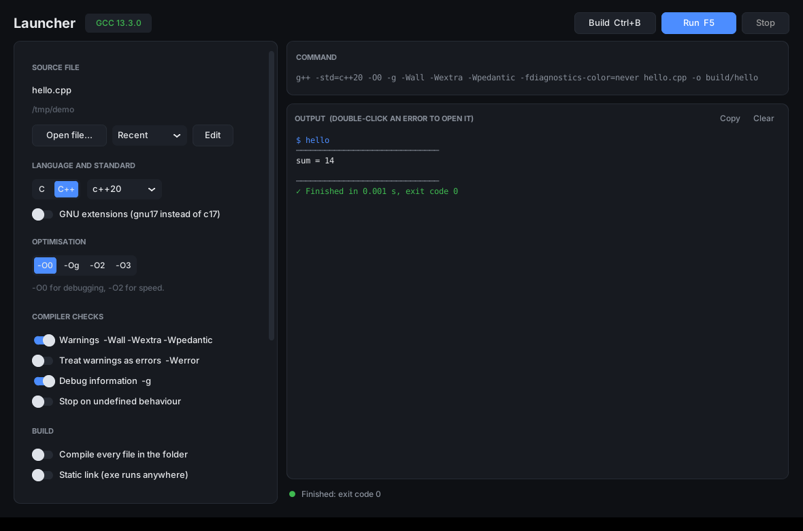

<p align="center"></p>

<p align="center">
  <a href="https://github.com/yassinox12834/cdevkit/releases/latest"></a>
  <a href="https://github.com/yassinox12834/cdevkit/actions/workflows/ci.yml"></a>
  
  
</p>

A small Python app that sets up a complete **GCC** development environment for C and C++ on **Windows, macOS and Linux**, plus a launcher that compiles and runs a single file with the standard you choose.

<p align="center">
  
  
</p>

## Start

For the version number, rely on the [latest GitHub release](https://github.com/yassinox12834/cdevkit/releases/latest). It is the reference; the badge above reads from it, and the files in this folder may be ahead of the last release. This README describes version **1.4.0**, and every version is listed in [CHANGELOG.md](CHANGELOG.md).

You'll need:

| | Windows | macOS | Linux |
|---|---|---|---|
| System | Windows 10 or 11 | a recent macOS | a desktop distribution using apt, dnf or pacman |
| Package installer | **winget** (the "App Installer" from the Microsoft Store, already there on most PCs) | Homebrew, which the app installs for you | already included |
| Rights | one UAC prompt per install | your password, once, for Homebrew | your password, once |
| Python | none: a private copy is downloaded if needed | none | none |

On every system you also need an internet connection (for the first start and for the installs) and room on the disk for the toolchain you choose. Python 3.10 or newer is only used if it is already installed; otherwise the app brings its own. Only if you run the code from source (see [Working on the code](#working-on-the-code)) do you need Python yourself, plus **PySide6-Essentials 6.8 to below 6.12**, which the start files install for you.

> **Prefer the terminal?** Every step is also written out as commands:
> [Windows](docs/install/WINDOWS.md) · [macOS](docs/install/MACOS.md) · [Linux](docs/install/LINUX.md)

**You do not need Python.** Unzip the folder and start the app:

| System | Open the setup app | Open the launcher |
|---|---|---|
| **Windows 10/11** | double-click `setup.bat` | `launcher.bat` |
| **macOS** | double-click `setup.command` | `launcher.command` |
| **Linux** | `./setup.sh` | `./launcher.sh` |

The first start takes a minute or two:

1. It looks for Python 3.10 or newer. If there is none, it downloads a private copy (about 60 MB, once) into a `.runtime` folder inside the kit, using [uv](https://github.com/astral-sh/uv). uv is pinned to one version and checked against its SHA-256 before it runs.
2. It installs the Qt interface, PySide6, into a `.venv` folder inside the kit (75 MB on Windows, about 110 MB on macOS, once).

Nothing is installed on your system: delete the folder and everything is gone. To always use the private Python, set the environment variable `CDEVKIT_PORTABLE=1`.

**Updating:** replace the files (or `git pull`) and start the app as usual. When `requirements.txt` has changed, the environment is rebuilt automatically on the next start.

There is deliberately **no .exe**. An unsigned .exe makes Windows SmartScreen show an "unrecognised app" warning, and avoiding that needs a paid code-signing certificate. Windows may still ask for confirmation once, because the zip came from the internet: to skip that, right-click the zip, choose **Properties**, tick **Unblock**, then extract. Cloning with `git clone` avoids it entirely. On macOS, if a `.command` file is blocked, right-click it and choose **Open**.

Then click **Install pack** on the Classic pack, go to **Verify** and click **Compile test programs**.

## Examples to test with

The `examples/` folder has 13 small C and C++ programs: hello world, input, pointers, classes, C++20 and C++23 features, a crash demo, and four programs that draw images (gradient, Sierpinski triangle, Mandelbrot set, shapes). See [examples/README.md](examples/README.md).

## How each system gets GCC

| | Windows | macOS | Linux |
|---|---|---|---|
| Installs programs with | winget | Homebrew | apt, dnf or pacman |
| GCC comes from | MSYS2 (UCRT64) | Homebrew (`gcc-15`, `g++-15`) | your distribution |
| Debugger | GDB | LLDB (Xcode tools), CodeLLDB in VS Code | GDB |
| PATH set up by the app | user PATH in the registry | `~/.zprofile` | nothing needed |
| Administrator rights | Windows prompt (UAC) | your password, in Terminal, once for Homebrew | one password dialog for all packages |

On macOS, plain `gcc` and `g++` are Apple Clang in disguise. The app always uses Homebrew's real GCC (`g++-15`) and warns you if only Clang is found.

## The packs

| Pack | Contents |
|---|---|
| **Classic** (recommended) | GCC, GDB, CMake + Ninja, Make, Git, VS Code, C/C++ and CMake Tools extensions. Plus MSYS2 on Windows; Xcode Command Line Tools, Homebrew and CodeLLDB on macOS |
| **Code quality** | clang-format, clang-tidy, clangd, Cppcheck, Catch2, GoogleTest, clangd and Error Lens extensions |
| **GitHub in VS Code** | Pull Requests, Actions and GitLens extensions |
| **Extras** | **GitHub CLI**, ccache, Doxygen, Google Benchmark, Doxygen comment generator, Hex Editor |

After installing, the app configures things: the toolchain goes on PATH, and VS Code's user settings get the compiler path (a dated backup such as `settings.json.20261122-204500.bak` is written first, the last five are kept, and your own values are kept). Editor habits such as format-on-save are not set globally: new projects get them in their own `.vscode/settings.json`.

## The setup app

| Page | What it does |
|---|---|
| **Packs** | Install a whole pack or single items. Installed items show a green dot and are skipped. |
| **Configure** | PATH, VS Code settings, Git identity, GitHub sign-in (`gh auth login`), and a **New project** generator: a CMake project with build (`Ctrl+Shift+B`) and debug (`F5`) already set up. |
| **Verify** | Shows the version of every tool, then compiles and runs a C and a C++ test program. On Windows it also warns when another MinGW comes before MSYS2's GCC on PATH. |

A **Cancel** button under the pages stops whatever is running, and any command that hangs is stopped after an hour.

## The launcher

Open a project folder or a single `.c` or `.cpp` file, pick C or C++ and the standard (C89 to C23, C++98 to C++26), choose warnings and optimisation, then press **F5**. The exact GCC command is shown above the output. Double-click an error to jump to that line in VS Code. Standards your GCC is too old for are hidden. Crashes are explained in words (access violation, stack overflow, missing DLL...).

**Open folder...** shows the folder in an explorer on the left, like VS Code's: C, C++ and header files each have their own icon, and a **green dot** marks every file that defines `main()`, the ones **F5** can build and run. Click a file to make it the current one, double-click it to open it in VS Code, right-click for Run, **Run as** (any of the run modes below), Build and Show in file manager. Opening a folder picks its first runnable file, so **F5** works straight away. `build/`, hidden folders and empty folders are left out; tick **Show other files** to see everything else. The tree follows the disk: new, renamed and deleted files show up by themselves, and a `main()` you add in VS Code gets its dot when you come back to the launcher. The folder is remembered, and `launcher_app.py <folder>` opens one directly.

| Shortcut | Action |
|---|---|
| `Ctrl+O` | Open a file |
| `Ctrl+Shift+O` | Open a folder |
| `Ctrl+B` | Build only |
| `F5` | Do what the run mode says (rebuilds first if a source, an included header, an option or the compiler changed) |
| `Shift+F5` | Stop the running program or the build |

The executable goes into a `build/` folder next to your source file, with a small `<name>.stamp.json` that records the command, the GCC version and the headers your code includes. That is how **F5** knows when to rebuild: changing `-O0` to `-O2`, a header in an `-Iinclude` folder or the compiler all trigger a new build, not only editing the `.c` or `.cpp` file.

### Run modes

**What F5 does** in the *Run* section picks one of seven modes. The big button at the top takes the mode's name (*Run*, *Make exe*, *Check*...), and the right-click menu of the explorer has them all under **Run as**.

| Mode | What it does | Output goes to |
|---|---|---|
| **Run here** | Builds if needed, runs in the Output panel. The **Input** box is sent to stdin. | `build/<name>` |
| **Run in a terminal** | Runs in its own terminal window: for programs that ask for input as they go (`scanf`, `std::cin`). | `build/<name>` |
| **Make a standalone executable** | Builds an optimised (`-O2`), stripped (`-s`), statically linked executable and does not run it. It works on another computer with the same system, without GCC. **Show executable** opens its folder. | `dist/<name>` (`.exe` on Windows) |
| **Make a standalone executable and run it** | The same, then starts it in a terminal with your normal environment, without GCC's folders on PATH, the way someone double-clicking it would. If it runs there, it really is standalone. | `dist/<name>` |
| **Check against expected output** | Runs with the **Input** box (or `<name>.in` next to the file) and compares what it prints with the **Expected output** box (or `<name>.out` / `<name>.ans`), like an online judge. Says *Accepted*, or the first line that differs. Spaces at line ends and blank lines at the end are ignored, nothing else. | `build/<name>` |
| **Benchmark** | Runs the program 2 to 1000 times with its output hidden, then shows the fastest, median, mean and slowest run. Choose `-O2` first: it warns if you measure a `-O0` build. | `build/<name>` |
| **Debug in a terminal** | Builds a `-O0 -g` copy and opens it in GDB (LLDB on macOS) in a terminal. GDB comes with the Classic pack. | `build/<name>-debug` |

Every mode keeps its own executable and its own rebuild record, so switching between *Run here* and *Make a standalone executable* does not rebuild each time. `dist/` is left out of the explorer, like `build/`.

About the standalone executable:

- **Windows**: fully static, so it needs none of MSYS2's DLLs. It is not signed, so SmartScreen may show the "unrecognised app" warning on other PCs (*More info* → *Run anyway*).
- **Linux**: fully static, so it runs on another Linux of the same architecture.
- **macOS**: Apple does not allow fully static programs. The GCC runtime (`libgcc`, `libstdc++`) is linked in, and the system libraries come from macOS itself, so it runs on other Macs with the same processor type.

A program that prints a lot does not slow the window down: if output arrives faster than it can be shown, the oldest waiting part is skipped and the log says so.

## Common problems

| Symptom | Fix |
|---|---|
| `gcc` not found in a terminal | Open a new terminal: PATH changes only reach new windows. |
| VS Code shows red squiggles on `#include` | Restart VS Code, or click **Configure VS Code for GCC**. |
| Windows: crash `0xC0000135` | A DLL is missing: add GCC to PATH, or switch on **Static link**. |
| Windows: crash `0xC0000139` | Another MinGW (from an old Code::Blocks, Strawberry Perl...) is earlier on PATH. The app puts MSYS2 first on your user PATH, but the system PATH always comes first: **Verify** names the culprit. Remove it or link statically. |
| macOS: Homebrew step "did not finish" | Complete the install in the Terminal window that opened, then click **Refresh status**. |
| Linux: "The Qt interface is installed but cannot start" | A minimal Linux (server, WSL, container) lacks the libraries Qt draws with. The message prints the install command for your distribution. |
| Linux: no password dialog appears | Your desktop has no `pkexec`; the app opens a terminal with `sudo` instead. |
| MSYS2 is not in `C:\msys64` | Set the environment variable `CDEVKIT_MSYS_ROOT` to its folder. |

AddressSanitizer is not supported by MinGW GCC on Windows. The launcher's **Stop on undefined behaviour** option uses UBSan in trap mode, which works on every system.

## Working on the code

Run from source with your own Python 3.10+:

```
python -m venv .venv
.venv/bin/pip install -r requirements.txt        # Windows: .venv\Scripts\pip
.venv/bin/python setup_app.py                    # or launcher_app.py
```

Run the tests (125 of them, including GUI tests drawn off screen, so no window opens):

```
QT_QPA_PLATFORM=offscreen python -m unittest discover tests     # PowerShell: $env:QT_QPA_PLATFORM="offscreen"
python tests/smoke.py                                           # needs GCC, CMake and Ninja
```

The GUI tests also measure how long the window stops responding while output floods in and while a 2 400-file folder is scanned, so a freeze shows up as a failing test. CI runs everything on Windows, macOS and Linux with Python 3.10 and 3.13.

PySide6 is kept below 6.12 in `requirements.txt`: version 6.12.0 crashes after about a thousand Qt callbacks on Python 3.10. Lift the cap once a 6.12.x release passes `tests/test_gui.py`.

## Project layout

```
setup_app.py          Setup window (packs, configure, verify)
launcher_app.py       Launcher window
setup.bat / .sh / .command, launcher.bat / .sh / .command
_common.bat / .sh     Shared by the start files: finds or downloads Python, installs PySide6
devkit/
  packs.py            The packs, with per-system package names. Edit this to add tools.
  installer.py        Detects and installs (winget, MSYS2, Homebrew, apt, dnf, pacman, VS Code)
  toolchain.py        Finds GCC, builds the command line, the run modes and the output check
  project.py          Scans a folder for the launcher's explorer and finds the files with main()
  project_template.py The "New project" CMake template
  vscode_settings.py  Safe merge into VS Code's settings.json
  configure.py        Git and GitHub actions
  system.py           PATH, processes, terminals, finding tools
  qt.py               Qt (PySide6) theme, shared widgets and background task runner
examples/             Test programs in C and C++, four of them draw .bmp images
docs/install/         Install guides with plain commands, one per system
CHANGELOG.md          What changed in each version
docs/banner.svg       Banner source (banner.png is rendered from it)
tests/                Unit and off-screen GUI tests: python -m unittest discover tests
tests/smoke.py        Builds and runs the hello examples with the real toolchain (used by CI)
.github/workflows/    CI on Windows, macOS and Linux
```

Settings for both apps are stored in `~/.cdevkit/`. If an app crashes, the details are written to `~/.cdevkit/crash.log`.

## Why Qt and not an .exe

Versions up to 1.1.0 used CustomTkinter, which redraws scrolling areas slowly enough to freeze the window. The interface now uses Qt through PySide6: native drawing and smooth scrolling. Installs and builds run in background threads, and their output reaches the window in small batches, so long jobs and chatty programs do not block it. It stays in Python on purpose. A compiled C++ interface would be an .exe, which brings back the SmartScreen warning, and the setup app's job is to install the compiler, so it cannot need one to start.

## Licence

MIT
