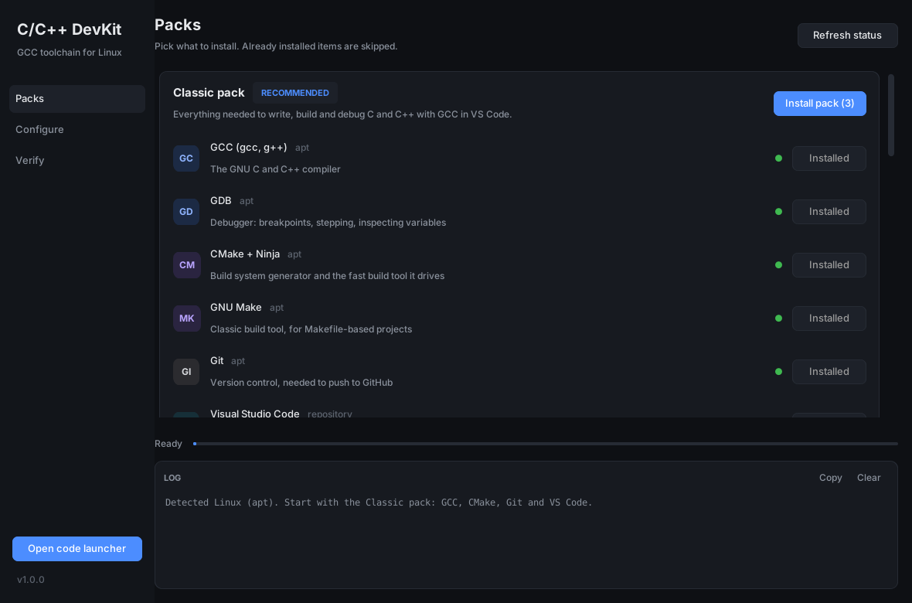

<p align="center"></p>

[](https://github.com/yassinox12834/cdevkit/actions/workflows/ci.yml)

A small Python app that sets up a complete **GCC** development environment for C and C++ on **Windows, macOS and Linux**, plus a launcher that compiles and runs a single file with the standard you choose.

<p align="center">
  
  
</p>

## Start

> **Prefer the terminal?** Every step is also written out as commands:
> [Windows](docs/install/WINDOWS.md) · [macOS](docs/install/MACOS.md) · [Linux](docs/install/LINUX.md)

**You do not need Python.** Unzip the folder and start the app:

| System | Open the setup app | Open the launcher |
|---|---|---|
| **Windows 10/11** | double-click `setup.bat` | `launcher.bat` |
| **macOS** | double-click `setup.command` | `launcher.command` |
| **Linux** | `./setup.sh` | `./launcher.sh` |

The first start looks for Python 3.10+ with Tkinter. If it finds one, it uses it. If not, it downloads a private copy of Python (about 60 MB, once) into a `.runtime` folder inside the kit, using [uv](https://github.com/astral-sh/uv). Nothing is installed on your system: delete the folder and everything is gone. To always use the private copy, set the environment variable `CDEVKIT_PORTABLE=1`.

There is deliberately **no .exe**. An unsigned .exe makes Windows SmartScreen show an "unrecognised app" warning, and avoiding that needs a paid code-signing certificate. Windows may still ask for confirmation once, because the zip came from the internet: to skip that, right-click the zip, choose **Properties**, tick **Unblock**, then extract. Cloning with `git clone` avoids it entirely. On macOS, if a `.command` file is blocked, right-click it and choose **Open**.

Then click **Install pack** on the Classic pack, go to **Verify** and click **Compile test programs**.

## Examples to test with

The `examples/` folder has 13 small C and C++ programs: hello world, input, pointers, classes, C++20 and C++23 features, a crash demo, and four programs that draw images (gradient, Sierpinski triangle, Mandelbrot set, shapes). See [examples/README.md](examples/README.md).

## How each system gets GCC

| | Windows | macOS | Linux |
|---|---|---|---|
| Installs programs with | winget | Homebrew | apt, dnf or pacman |
| GCC comes from | MSYS2 (UCRT64) | Homebrew (`gcc-15`, `g++-15`) | your distribution |
| Debugger | GDB | LLDB (Xcode tools), CodeLLDB in VS Code | GDB |
| PATH set up by the app | user PATH in the registry | `~/.zprofile` | nothing needed |
| Administrator rights | Windows prompt (UAC) | your password, in Terminal, once for Homebrew | one password dialog for all packages |

On macOS, plain `gcc` and `g++` are Apple Clang in disguise. The app always uses Homebrew's real GCC (`g++-15`) and warns you if only Clang is found.

## The packs

| Pack | Contents |
|---|---|
| **Classic** (recommended) | GCC, GDB, CMake + Ninja, Make, Git, VS Code, C/C++ and CMake Tools extensions. Plus MSYS2 on Windows; Xcode Command Line Tools, Homebrew and CodeLLDB on macOS |
| **Code quality** | clang-format, clang-tidy, clangd, Cppcheck, Catch2, GoogleTest, clangd and Error Lens extensions |
| **GitHub in VS Code** | Pull Requests, Actions and GitLens extensions |
| **Extras** | **GitHub CLI**, ccache, Doxygen, Google Benchmark, Doxygen comment generator, Hex Editor |

After installing, the app configures things: the toolchain goes on PATH, and VS Code's user settings get the compiler path (a backup is written to `settings.json.bak` first, and your own values are kept).

## The setup app

| Page | What it does |
|---|---|
| **Packs** | Install a whole pack or single items. Installed items show a green dot and are skipped. |
| **Configure** | PATH, VS Code settings, Git identity, GitHub sign-in (`gh auth login`), and a **New project** generator: a CMake project with build (`Ctrl+Shift+B`) and debug (`F5`) already set up. |
| **Verify** | Shows the version of every tool, then compiles and runs a C and a C++ test program. |

## The launcher

Open a `.c` or `.cpp` file, pick C or C++ and the standard (C89 to C23, C++98 to C++26), choose warnings and optimisation, then press **F5**. Double-click an error to jump to that line in VS Code. Standards your GCC is too old for are hidden. Crashes are explained in words (access violation, stack overflow, missing DLL...).

| Shortcut | Action |
|---|---|
| `Ctrl+O` | Open a file |
| `Ctrl+B` | Build only |
| `F5` | Run (rebuilds first if a source changed) |
| `Shift+F5` | Stop the running program |

The executable goes into a `build/` folder next to your source file. For programs that read input (`scanf`, `std::cin`), switch on **Run in a separate terminal** or type the input in the Input box.

## Common problems

| Symptom | Fix |
|---|---|
| `gcc` not found in a terminal | Open a new terminal: PATH changes only reach new windows. |
| VS Code shows red squiggles on `#include` | Restart VS Code, or click **Configure VS Code for GCC**. |
| Windows: crash `0xC0000135` | A DLL is missing: add GCC to PATH, or switch on **Static link**. |
| Windows: crash `0xC0000139` | Another MinGW (from an old Code::Blocks, Strawberry Perl...) is earlier on PATH. Remove it or link statically. |
| macOS: Homebrew step "did not finish" | Complete the install in the Terminal window that opened, then click **Refresh status**. |
| Linux: no password dialog appears | Your desktop has no `pkexec`; the app opens a terminal with `sudo` instead. |
| MSYS2 is not in `C:\msys64` | Set the environment variable `CDEVKIT_MSYS_ROOT` to its folder. |

AddressSanitizer is not supported by MinGW GCC on Windows. The launcher's **Stop on undefined behaviour** option uses UBSan in trap mode, which works on every system.

## Project layout

```
setup_app.py          Setup window (packs, configure, verify)
launcher_app.py       Launcher window
setup.bat / .sh / .command, launcher.bat / .sh / .command
devkit/
  packs.py            The packs, with per-system package names. Edit this to add tools.
  installer.py        Detects and installs (winget, MSYS2, Homebrew, apt, dnf, pacman, VS Code)
  toolchain.py        Finds GCC and builds the command line
  project_template.py The "New project" CMake template
  vscode_settings.py  Safe merge into VS Code's settings.json
  configure.py        Git and GitHub actions
  system.py           PATH, processes, terminals, finding tools
  ui.py               Theme and shared widgets
examples/             Test programs in C and C++, four of them draw .bmp images
docs/install/         Install guides with plain commands, one per system
docs/banner.svg       Banner source (banner.png is rendered from it)
tests/test_core.py    python -m unittest discover tests
```

Settings for both apps are stored in `~/.cdevkit/`.

## Licence

MIT
